<p align="center">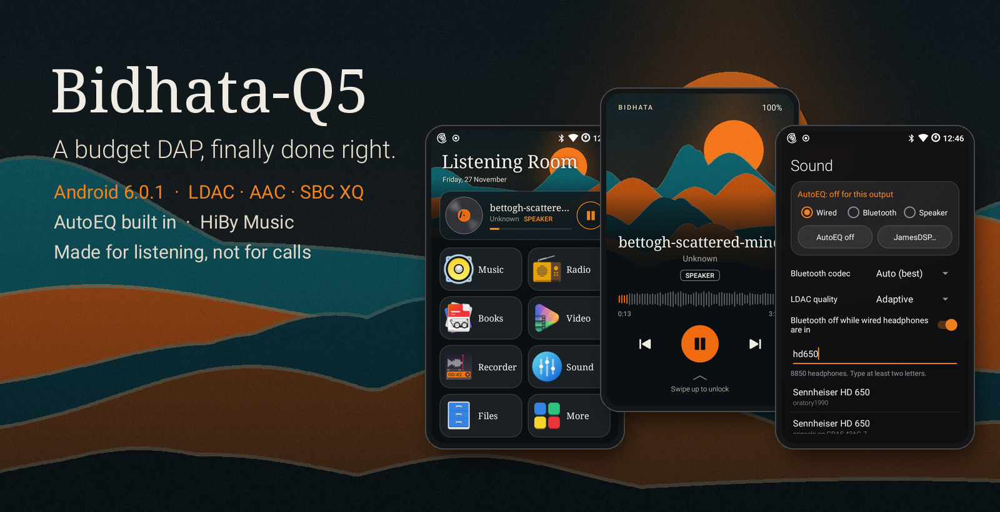</p>

# Bidhata-Q5

**A cheap little music player, finally done right.**

The TIMMKOO Q5 is one of those budget Android DAPs that costs less than a decent pair of earphones.
The hardware is honestly decent: a quad-core MediaTek chip, a proper 3.5 mm output,
Bluetooth, Wi-Fi, FM radio, a microSD slot. The software it ships with is not. It's
Android 4.4 from 2014, the Bluetooth stack only speaks SBC, and half the apps you'd want
don't install anymore.

Bidhata-Q5 is my own ROM for it. Android 6.0.1, built from source, with **LDAC and AAC
Bluetooth**, a home screen and lockscreen designed for listening rather than for a phone,
system-wide **AutoEQ**, and every rough edge I could find sanded down. It turns a
throwaway gadget into a DAP I actually reach for.

<p align="center">
  <a href="docs/screens/demo.mp4"></a><br>
  <sub>Boot, unlock, play, tune. Everything here is recorded on a real Q5. Tap for the full video.</sub>
</p>

---

## What you get

**Sound first**

- **LDAC** (990 / 660 / 330 kbps, or adaptive), **AAC** and **SBC XQ** over Bluetooth,
  added to the stock Bluetooth stack from source. Pick the codec and LDAC quality right on
  the Sound page.
- **AutoEQ built in.** Type your headphone model, tap it, done. Around 8,800 measured
  headphones from the AutoEQ database, applied system-wide through JamesDSP, separately
  for wired, Bluetooth and the speaker. Profiles are saved, so they work offline too.
- **Better resampling** (Android's high-quality resampler) for anything that isn't 44.1 kHz.
- **Louder speaker.** The stock volume table held the amp 11 dB below its limit. Now it's 3 dB.
- **USB DACs** work through an OTG adapter (the kernel has USB audio support).
- **HiBy Music** comes preinstalled, the last version that still runs on this hardware.

**Looks like a DAP, not a phone**

- **Listening Room** home: big tiles, a now-playing strip that only shows up while
  something plays, and a turning vinyl record when a track has no cover art.
- A **lockscreen built around the music**: the cover fades into the page, a waveform
  progress bar, big controls. When nothing plays you get a calm landscape and a big clock.
- A custom boot animation, and **you can put your own name on it** (More → Boot screen name).
- Dark, amber-accented Settings, FM Radio and Recorder to match.

**Everything a player needs, nothing it doesn't**

- **Apps**: Cool Reader (page-curl animation, Bengali and other Indic scripts rendered
  properly), VLC, Material Files, Markor, F-Droid, Calculator++, alarm clock, HeliBoard keyboard.
- **Wi-Fi Share**: browse and copy music to and from the player from any browser on your network.
- **Scheduled power**: switch off at night, switch itself back on in the morning.
- **Bluetooth switches off** by itself when you plug in wired headphones, and back on when you unplug.
- The screen **stays awake while reading, watching video or recording**.
- All the phone stuff (dialer, contacts, calendar, camera, browser) is gone.

**Quietly sturdy**

- Proper thermal protection: the CPU throttles and the battery is guarded when things get hot.
- 256 MB of compressed RAM so apps stay open on a 1 GB device.
- Doze, calmer Wi-Fi scanning and fewer background services for better battery.
- A unique Bluetooth and Wi-Fi address per unit (the stock firmware shipped every unit with the same one).

---

## Screenshots

| | | |
|:---:|:---:|:---:|
| 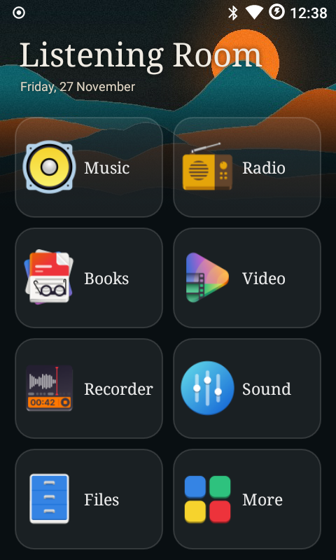<br>Home | 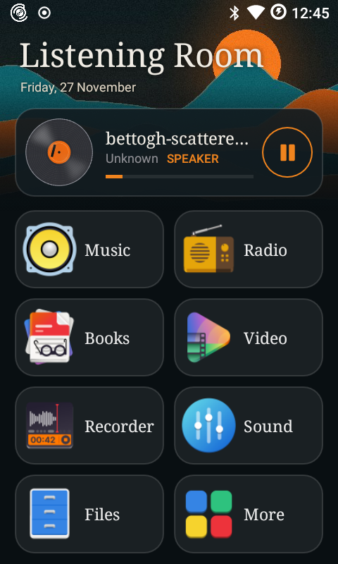<br>Home, playing | 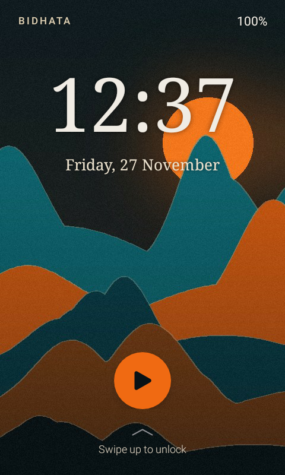<br>Lockscreen |
| 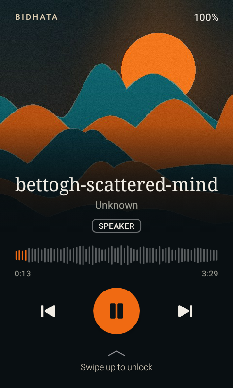<br>Lockscreen, playing | 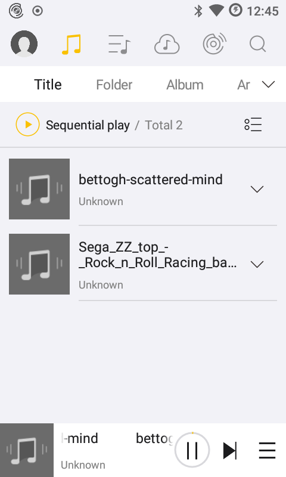<br>HiBy Music | 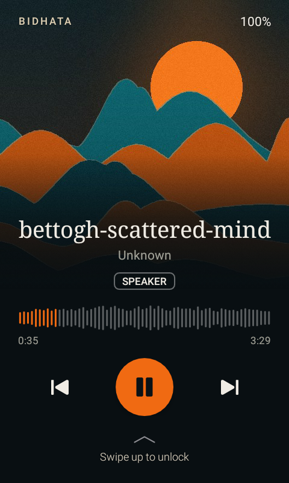<br>More |
| 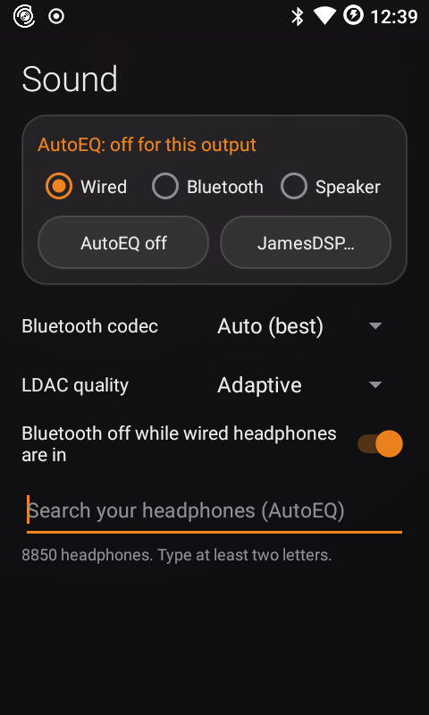<br>Sound | 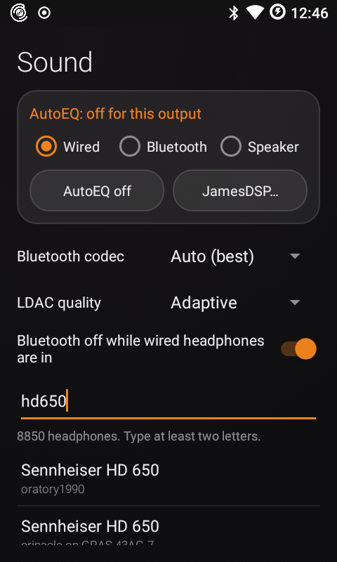<br>AutoEQ search | 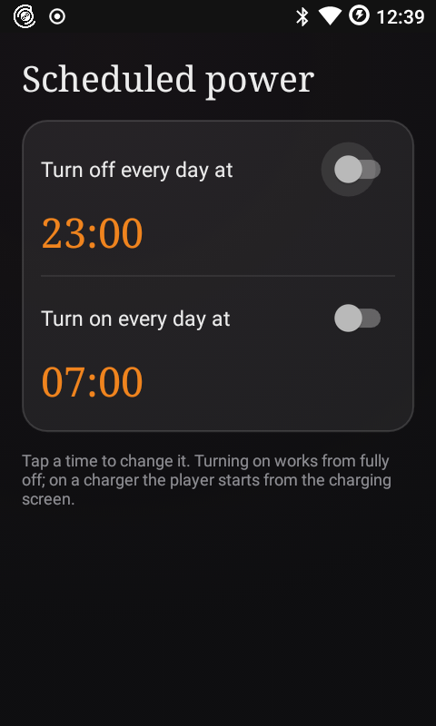<br>Scheduled power |
| 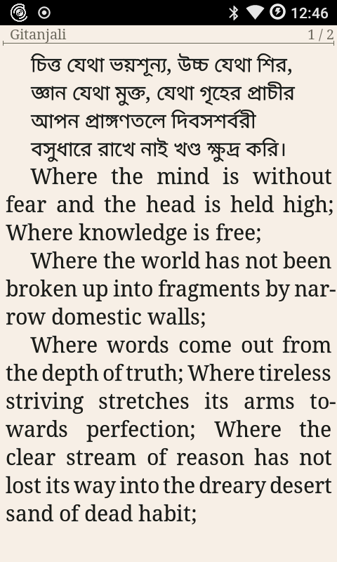<br>Cool Reader | 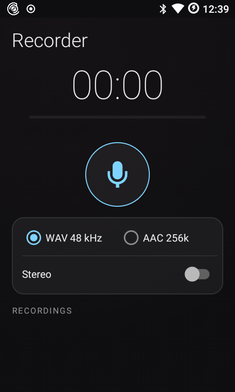<br>Recorder | 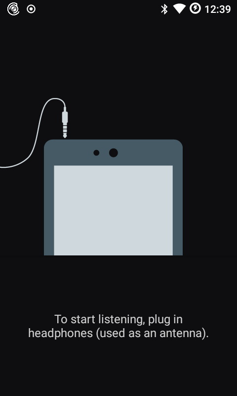<br>FM Radio |
| 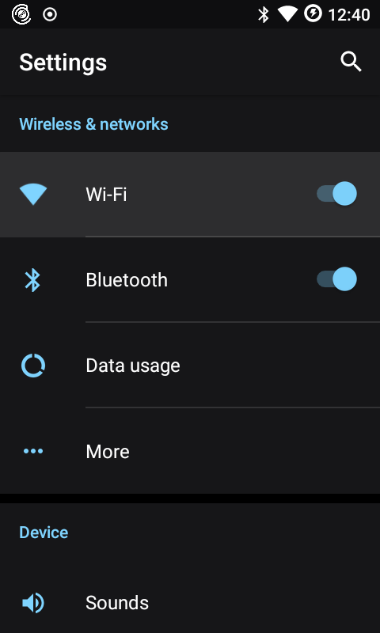<br>Settings | 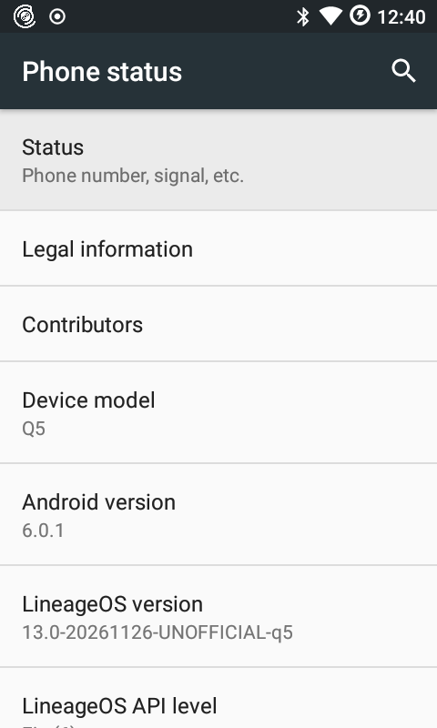<br>About | <br>Boot |

---

## The device

| | |
|---|---|
| Player | TIMMKOO Q5 (board `j5052`, also sold under other names) |
| Chip | MediaTek MT6582, 4 × Cortex-A7 at 1.3 GHz, Mali-400 GPU |
| Memory | 1 GB RAM, 8 GB storage, microSD |
| Screen | 480 × 800 touchscreen |
| Wireless | Bluetooth 4.0, 2.4 GHz Wi-Fi, FM radio (your wired earphones are the antenna) |
| Stock software | Android 4.4.2 |
| Bidhata-Q5 | Android 6.0.1 (LineageOS cm-13.0 base) |

---

## What works

| | |
|---|---|
| Wired audio, speaker | ✅ |
| Bluetooth LDAC / AAC / SBC XQ / SBC | ✅ |
| AutoEQ, JamesDSP | ✅ |
| Wi-Fi, Wi-Fi Share | ✅ |
| FM radio | ✅ opens and tunes with wired earphones plugged in |
| Recorder | ✅ |
| Charging (also when switched off) | ✅ |
| Scheduled power on/off | ✅ |
| USB DAC (OTG) | should work, test welcome |
| SELinux | permissive for now |

Found something that doesn't? Open an issue with what you did and what happened.

---

## Install

**[The step-by-step install guide](docs/INSTALL.md)** walks you through it. It's mostly
double-clicking scripts and waiting. The short version:

- **From stock firmware** (once, needs a Windows PC, about an hour): download
  `Bidhata-Q5-<version>-pc-install.zip` from Releases, then run `setup-mtkclient.bat`,
  `backup.bat` and `install.bat`. Every write is read back and checked. TWRP comes with it.
- **Updates** (no PC): copy `Bidhata-Q5-<version>-update.zip` to the player, tap
  **More → Power & updates → Restart into TWRP**, and install the zip. Music, apps and settings
  stay.
- **Changed your mind?** `restore-stock.bat` puts your backup back.

> The first install **erases the player's internal storage** (the microSD card is safe), so
> copy your music off first. The scripts never touch the bootloader, so a failed attempt can
> always be retried. Things still go wrong sometimes with flashing; I'm not responsible for
> bricked players, but I'll gladly help you unbrick one.

---

## Build it yourself

Two commands, once you have Docker, ~60 GB of disk and TIMMKOO's **T-ROM V2.3** zip
(their Android 5.0 package for the Q5, from timmkoo.de; the MediaTek drivers come from it):

```bash
mkdir bidhata && cd bidhata
curl -fsSLO https://raw.githubusercontent.com/bidhata/Bidhata-Q5/main/tools/setup.sh
bash setup.sh ~/Downloads/T-ROM_V.2.3_without_Flashtool.zip   # sync, patch, drivers, apps
device/timmkoo/q5/tools/build.sh                                # boot.img + system.img
```

The build runs in a small Ubuntu 14.04 container, the host LineageOS cm-13.0 expects, so your
own machine stays untouched. The patches in `patches/` are plain `git diff`s, easy to read:

- `patches/system/bt`: LDAC (with adaptive bitrate), AAC and SBC XQ in bluedroid.
- `patches/frameworks/base`: the power-on alarm behind scheduled power.
- `patches/system/core`: init fixes for this board.

Want to change the home screen or add a feature? [CONTRIBUTING.md](CONTRIBUTING.md) has a
two-minute edit, push, reboot loop that doesn't need a full build. Every push and pull request
is checked automatically, and new releases are built from tags ([docs/RELEASING.md](docs/RELEASING.md)).

---

## Thanks

Bidhata-Q5 stands on a lot of other people's work. Thank you to:

**The system**
- **LineageOS** (cm-13.0) and the **Android Open Source Project**, which all of this sits on.
- **TheMuppets** and the Android One (sprout) maintainers, for the MT6582 pieces.
- **TIMMKOO**, for the player and their T-ROM package the drivers and kernel come from.
- **TWRP** (TeamWin), for the recovery.
- **mtkclient** by Bjoern Kerler, which makes installing possible at all, and **Zadig / libwdi**
  by Pete Batard for the USB driver.

**The sound**
- **JamesDSP** by James Fung, the system-wide audio engine.
- **AutoEQ** by Jaakko Pasanen, for the headphone measurements and corrections.
- **libldac** (Sony, Apache 2.0) for LDAC, and the **Fraunhofer FDK AAC** encoder in Android.

**The look**
- **GNOME** and its app authors for the icons (CC-BY-SA 3.0 / their own licences; details in
  `apps/BidhataLauncher/ICONS.md`).
- **Mozilla**, for the root certificate list that lets a 2015 Android talk to today's web.

**The apps that make it a complete player**
- **HiBy Music** (HiBy), **VLC** (VideoLAN), **Cool Reader** (Vadim Lopatin and contributors),
  **HeliBoard** (Helium314 and contributors), **Material Files** (Hai Zhang),
  **Markor** (Gregor Santner), **F-Droid**, and **Calculator++** (Sergey Solovyev).

And the people who tear these cheap players apart and write it up. You know who you are.

## Licence

My own code in this tree is Apache 2.0 (see [LICENSE](LICENSE)). Everything else keeps its own
licence. JamesDSP (`prebuilt/jamesdsp`) is GPL-3.0; its source is at
<https://github.com/james34602/JamesDSPManager>. Proprietary
MediaTek files and third-party APKs are not in this repo: `extract-files.sh` takes the drivers
from TIMMKOO's T-ROM package and `tools/fetch-apps.sh` downloads the apps from their official
sources.

---

Made with patience and a lot of reboots by **Krish Paul**.
If it brought your Q5 back to life, a ⭐ helps other owners find it.
